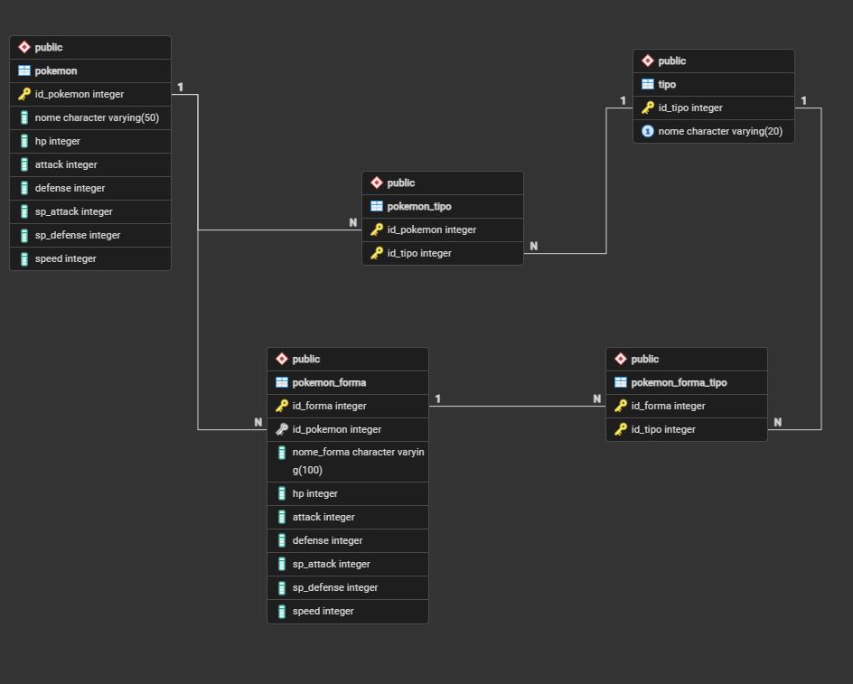

# Pokémon VGC Database

Projeto de estudo em **PostgreSQL e SQL** para organizar Pokémon, formas alternativas, tipos e estatísticas em um banco relacional e explorar esses dados por consultas e visualizações.

**Disponibilidade:** scripts SQL, modelo relacional e capturas de análises públicos.

**Foco:** modelagem de dados · relacionamentos · consultas analíticas · visualização.

## Objetivo e participação

Meu trabalho neste projeto reúne a estruturação do modelo relacional, a organização dos scripts e a elaboração de consultas para comparar estatísticas de Pokémon base e suas formas. O repositório também documenta análises no Looker Studio.

O contexto competitivo VGC motiva o tema; o projeto não implementa um simulador de batalhas nem um sistema de recomendação de equipes.

## Modelo relacional

| Tabela | Responsabilidade |
| --- | --- |
| `pokemon` | Identificação, nome e seis estatísticas dos Pokémon base |
| `pokemon_forma` | Formas alternativas e suas estatísticas, com referência ao Pokémon base |
| `tipo` | Catálogo de tipos, com nome único |
| `pokemon_tipo` | Associação N:N entre Pokémon base e tipos |
| `pokemon_forma_tipo` | Associação N:N entre formas alternativas e tipos |

Os scripts definem chaves primárias, chaves estrangeiras e chaves compostas nas associações. A separação das entidades permite representar formas com tipos e estatísticas diferentes da base.

**Limite do esquema:** a regra de até dois tipos por Pokémon não está imposta pelos scripts. A referência de uma forma ao Pokémon base aceita nulo no esquema atual.

## Consultas implementadas

| Pergunta ou análise | Evidência no repositório |
| --- | --- |
| Como consultar base e formas com tipos e total de estatísticas? | [Consulta consolidada](queries/pokemon_completo.sql) e [view](views/vw_pokemon_completo.sql) |
| Quais são os 15 maiores valores de velocidade, incluindo formas? | [Ranking de velocidade](queries/top_speed.sql) |
| Quais Pokémon base atingem a maior velocidade, incluindo empates? | [Máximo com subconsulta](queries/Max_speed_exemple.sql) |
| Qual a média da soma das estatísticas de base e formas? | [Média de stats](queries/media_stats.sql) |
| Quantos Pokémon base estão associados a cada tipo? | [Contagem por tipo](queries/contagem_pokemon_por_tipo.sql) |
| Quais Pokémon têm simultaneamente os tipos Fire e Grass? | [Interseção](queries/fire_and_grass_intersect.sql) |
| Como combinar conjuntos Fire e Grass? | [União](queries/fire_grass_pokemon_union.sql) |
| Quais Pokémon Flying não têm o tipo Normal? | [Diferença de conjuntos](queries/Flying_Except_Normal.sql) |
| Quais Pokémon base não possuem forma cadastrada? | [Diferença entre base e formas](queries/except_pokemon_forma.sql) |

As consultas aplicam `JOIN`, `GROUP BY`, `STRING_AGG`, `UNION`, `UNION ALL`, `INTERSECT`, `EXCEPT`, agregações, subconsulta e ordenação. A view calcula a soma das seis estatísticas como `total_base_stats` e consolida base e formas.

## Visualizações já documentadas

A seção [BI & Analytics](bi/README.md) registra análises no **Looker Studio**, com rankings de velocidade dos tipos Fire e Rock.

[Ver captura do tipo Rock](bi/screenshots/Rock%20Sped.png).

As imagens são registros das análises existentes. Não há painel interativo publicado neste repositório; a consulta SQL específica que alimentou cada gráfico não está identificada na documentação atual.

## Como explorar os arquivos

1. Comece pelo modelo acima e pelos scripts em [`schema/`](schema/).
2. Consulte [`data/`](data/) para conhecer os modelos de inserção.
3. Explore [`queries/`](queries/) e a definição em [`views/`](views/).
4. Consulte [`bi/`](bi/) para as capturas e a descrição das análises.

### Limitações para executar em um banco novo

- `data/` contém modelos de `INSERT` com marcadores `?`, e não uma carga de dados pronta. Os marcadores precisam ser substituídos ou vinculados por um cliente compatível.
- Os scripts referenciam as sequências `tipo_id_tipo_seq` e `pokemon_forma_id_forma_seq`, mas não incluem sua criação.
- Os comandos de propriedade usam o papel `postgres`; outras instalações podem exigir adaptação.
- Não há base populada nem ambiente automatizado para reproduzir os resultados. Nesta revisão documental, os scripts foram inspecionados, sem execução em PostgreSQL.

## Competências e aprendizados

- Representar entidades e relações N:N com tabelas associativas.
- Relacionar registros de base e formas sem repetir o catálogo de tipos.
- Consolidar informações com joins, agregações e operações de conjuntos.
- Transformar perguntas sobre os dados em consultas SQL e visualizações.
- Identificar a diferença entre scripts de estudo e um pacote reproduzível de banco de dados.

## Próximos passos

- Completar a preparação das sequências e documentar uma carga de dados reproduzível.
- Rever as restrições de integridade e a obrigatoriedade dos relacionamentos.
- Documentar a origem e o recorte dos dados e as consultas usadas nos dashboards.
- Explorar uma API de consulta e ampliar as análises.

Esses itens são melhorias futuras, não recursos já entregues.
